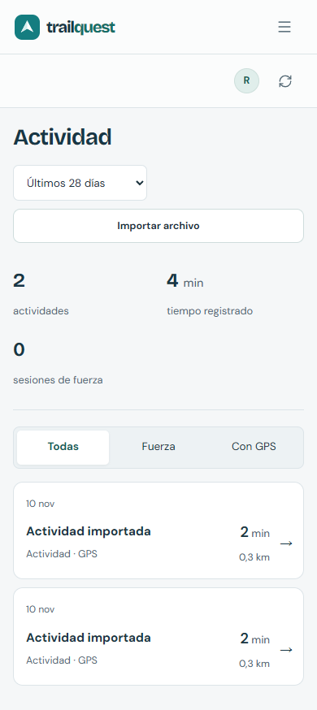

# TrailQuest Web

[English](README.md) · [Contribuir](CONTRIBUTING.md) · [Seguridad](SECURITY.md) · [Licencia](LICENSE)

Interfaz React del archivo privado de actividad y aventuras de TrailQuest. Permite consultar pasos, salud y grabaciones; avanzar por rutas virtuales con fotografías reales; distinguir sellos conseguidos y pendientes; y preparar publicaciones voluntarias para amistades. Las mediciones ausentes no se convierten en ceros inventados.

Este es un **repositorio Git y una imagen web independientes**. La API .NET tiene su propio repositorio e imagen. El navegador siempre usa `/api/v1` desde el mismo origen: no contiene contraseñas, claves Garmin ni la IP de tu servidor. Mostrar datos no genera aventuras ni inicia importaciones.

## Interfaz




Capturas reales de la app, no maquetas; las cuentas y registros se crearon solo para la prueba aislada. Las fotografías conservan sus [créditos y condiciones](docs/screenshots/PHOTO_CREDITS.md).

## Desarrollo local

Usa **Node 22.12+ con parches o Node 24 LTS**, con npm. El contenedor fija Node 24 y el digest de su imagen.

```bash
npm ci --no-fund
npm run dev
```

Arranca antes la API independiente en su puerto loopback y abre la dirección de Vite. El alta inicial en la interfaz solo corresponde a la API local; CasaOS configura el propietario desde la consola privada de la API. No hay cuentas de ejemplo: las crea el propietario. El perfil predeterminado es personal y los controles de prueba solo aparecen si la API los activa.

Las variables exclusivas de desarrollo son `TRAILQUEST_WEB_PORT` y `TRAILQUEST_API_PROXY_TARGET`; esta última solo acepta un origen loopback sin credenciales ni ruta. Ninguna es secreta ni cambia el origen del navegador en producción. No pongas secretos en `VITE_*`, almacenamiento del navegador, código o recursos públicos.

## Comprobar

```bash
npm run build
npm run lint
npm run test
npm run test:runtime
```

Antes de compilar o desarrollar se comprueba `VERSION` frente al manifiesto y se generan `public/version.json`, los textos completos de licencias y el inventario CycloneDX bajo `public/licenses/`. Los generados, dependencias y compilaciones están ignorados por Git. Las pruebas usan datos sintéticos; las del lanzador se ejecutan con Node, separadas de jsdom.

Para comprobar contenedores/navegador, la API incluye `scripts/container-smoke.mjs`: crea stack local aislado, cuentas sintéticas, proxy TLS de prueba y ensayo de recuperación, y después lo detiene. Para incorporar `scripts/container-browser.mjs` de este repo, instala expresamente herramientas temporales fijadas (`@playwright/test` 1.58.2 y `@axe-core/playwright` 4.10.2), apunta `TRAILQUEST_BROWSER_TOOLS` a ese package.json temporal y `TRAILQUEST_SMOKE_BROWSER_HOOK` a este helper. Usa Chrome instalado, bloquea tiles reales y rechaza destinos no sintéticos/no loopback. Nunca le proporciones cuentas reales.

## Docker y CasaOS

```bash
docker build --build-arg RELEASE_VERSION=1.0.0 -t trailquest-web:1.0.0 .
```

La imagen sirve recursos compilados con **Nginx sin root en el puerto 8080**, admite raíz de solo lectura y `/tmp` escribible y publica `/healthz` como estado de vida, sin ocupar la página `/health` de la app. No necesita volumen de base de datos. Despliégala junto a la API de la misma versión usando `deploy/docker-compose.yml` y la guía de CasaOS del repositorio de la API.

| Nombre en ejecución | Finalidad |
| --- | --- |
| `TRAILQUEST_API_UPSTREAM` | Nombre Docker y puerto internos de la API, no una URL para el navegador |
| `TRAILQUEST_TRUSTED_FORWARDER` | IP exacta del proxy HTTPS inmediato; nunca red o comodín |

Se validan y escriben en la configuración de Nginx, **no en JavaScript ejecutable**. Solo el proxy configurado puede indicar HTTPS; Nginx sustituye las cabeceras enviadas a la API privada y se conservan sus comprobaciones de origen y cookies. Restringe el puerto HTTP privado al proxy. La dirección HTTPS, red y volúmenes se configuran en Compose, sin recompilar la interfaz.

### Publicación automática en GHCR

Los pushes a `main` o `master` ejecutan las comprobaciones reutilizables de compilación/lint/tests/arranque/auditoría, construyen la imagen Linux amd64 y la analizan antes de publicar. Las pull requests verifican sin publicar; también se admite ejecución manual en las ramas/tags de versión admitidos. `GITHUB_TOKEN` aporta el permiso de registro limitado al job; no necesitas otro token personal, clave Garmin ni secretos `VITE_*`.

- Rama predeterminada: `ghcr.io/david-h-afonso/trailquest-web:latest`, el tag de rama y `sha-<commit-completo>`.
- Otra rama admitida: tags de rama y commit, sin sustituir `latest`.
- Tag Git `v1.0.0` coincidente con `VERSION`: añade tags de imagen `1.0.0` / `v1.0.0`, rechazando versiones ya publicadas. Los commits normales no necesitan cambiar la versión ni crear un tag.

Tras la primera publicación correcta, usa la imagen directamente en CasaOS o ejecuta:

```bash
docker pull ghcr.io/david-h-afonso/trailquest-web:latest
```

El resumen de Actions incluye tags, digest y comando de descarga fijada. Los forks usan su propio propietario en minúsculas. Los paquetes GHCR deben ser públicos para descargar sin iniciar sesión; si no, autentica Docker en el servidor. Actualiza API/web juntas con la guía de CasaOS de API; `latest` es una referencia móvil, así que conserva los digests probados para recuperar. No hay workflows programados ni despliegue automático a producción. Revisa los términos de terceros/fotos y los minutos de Actions en repos privados antes de distribuir.

## Privacidad e interacción

- Se utiliza la cookie HttpOnly y limitada al host de la API; no hay tokens en Redux/localStorage. Cambiar de perfil/cuenta no muestra registros cacheados de otra persona.
- HTTP directo por LAN requiere activar expresamente ese modo en API; no basta con cambiar la URL de Web. HTTPS sigue siendo el valor predeterminado para Internet. Si el navegador HTTP no tiene API de portapapeles, las credenciales de un solo uso permiten copia manual sin lanzar un error.
- Cada perfil tiene un solo pasaporte activo. Puedes salir o confirmar un cambio sin borrar avance, fecha de inicio ni sellos; los inactivos dejan de sumar. Retomar cuenta los nuevos pasos registrados desde hoy, no los días inactivos. El resto de la app sigue disponible sin una aventura activa.
- Ajustes enlaza directamente con la clave de API personal de Garmin Connect y explica la configuración. Si Garmin ya está conectado, la sustitución permanece plegada; cerrarla vacía el valor introducido y la clave guardada nunca se muestra.
- Los modales cierran con Escape, botón o pulsación exterior real, devuelven el foco y conservan las acciones visibles. Los avisos desaparecen solos y pausan su temporizador al leerlos.
- GPS muestra primero el trazado privado sin proveedor. Abrir tiles OpenStreetMap es explícito; las pruebas interceptan las peticiones y no recorren servidores públicos.
- Los ejemplos son opcionales y están apagados en producción. No rellenan tu salud personal. Al desactivarlos se oculta el selector; reiniciarlos nunca borra actividad personal.
- Las exportaciones son privadas. La interfaz puede pedir fechas y comprueba que la API respetó el intervalo. El JSON no es una copia de recuperación completa ni una restauración JSON implementada.
- Ajustes también prepara JSON diario de Garmin para un intervalo y todos o algunos conjuntos, con botones para copiar o descargar. Los datos sensibles requieren confirmación; no incluye claves ni originales/trazados GPS y nunca se envía automáticamente a ChatGPT.

## Licencia y ayuda

Código propio: **MIT**. Las dependencias conservan sus términos. **React Leaflet usa Hippocratic-2.1, no solo MIT**, y cada fuente conserva su copyright y OFL completo. Consulta los [avisos de terceros](THIRD_PARTY_NOTICES.md) o **Ajustes → Acerca de TrailQuest → Licencias y créditos**. Fotos y mapas se acreditan desde los packs de la API; el SDK Garmin pertenece al backend y tiene otras condiciones.

Si falla la sesión, revisa API y dirección HTTPS, sin saltarte validaciones ni permitir CORS indiscriminado. Ante un 413 del archivo, reduce el periodo. Si falla el proveedor del mapa, usa el esquema local. En incidencias normales incluye versiones y reproducción sin datos privados; utiliza [SECURITY.md](SECURITY.md) para informes sensibles. No adjuntes salud real ni credenciales.
