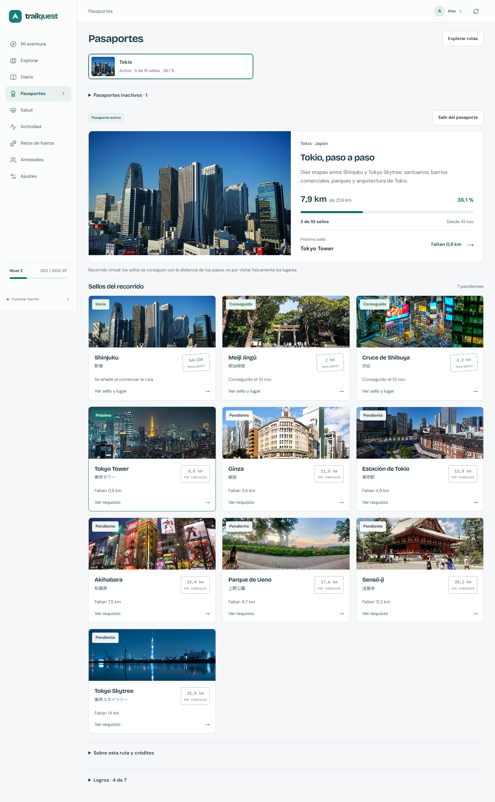
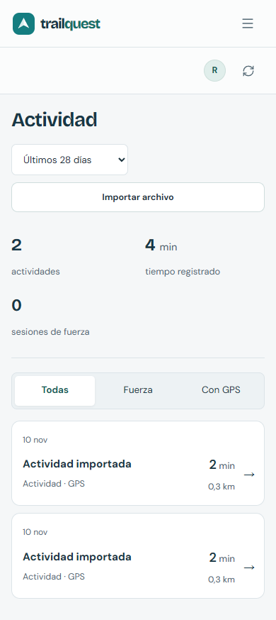

# TrailQuest Web

[Español](README.es.md) · [Contributing](CONTRIBUTING.md) · [Security](SECURITY.md) · [License](LICENSE)

React interface for TrailQuest's private activity archive and walking adventures. View steps, health and recorded activities; follow virtual routes with real-place photographs; collect clearly marked stamps; and preview voluntary friend-only sharing. Missing measurements stay missing, not fabricated zeroes.

This is an **independent Git repository and web image**. The .NET API is a separate repository/image. The browser always calls same-origin `/api/v1`; it contains no account password, Garmin key or baked-in server IP. It does not generate adventures or start imports just by displaying data.

## Interface





Real application captures, not mockups; records/accounts were created only for isolated verification. Embedded photographs retain their separate [credits and screenshot terms](docs/screenshots/PHOTO_CREDITS.md).

## Local development

Use a patched **Node 22.12+ or Node 24 LTS**, with npm. The container build pins Node 24 and its image digest.

```bash
npm ci --no-fund
npm run dev
```

Start the separate API on its loopback development port first, then open the Vite URL. Owner setup is available only through the local API; CasaOS first-owner bootstrap uses the private API console. Accounts are created by the installation owner, not fixtures. Personal data is the default profile; optional demo controls appear only when the API enables them.

Development-only variables are `TRAILQUEST_WEB_PORT` and `TRAILQUEST_API_PROXY_TARGET`. The latter accepts only a loopback origin without credentials/path. Neither is a secret, and neither changes the production browser API path. Do not put secrets in `VITE_*`, browser storage, source or public assets.

## Verify

```bash
npm run build
npm run lint
npm run test
npm run test:runtime
```

Build/dev preparation checks `VERSION` against package metadata and generates `public/version.json` plus full license texts and a CycloneDX declared-runtime/helper inventory under `public/licenses/`. Generated files, dependencies and outputs are ignored by Git. Unit tests use synthetic fixtures; the launcher-runtime tests run under Node separately from jsdom.

For real container/browser proof, the API repository provides `scripts/container-smoke.mjs`. It creates an isolated local stack, synthetic accounts, a test-only loopback TLS proxy and a restore exercise, then stops the stack. To include this repo's `scripts/container-browser.mjs`, explicitly install pinned temporary tools (`@playwright/test` 1.58.2 and `@axe-core/playwright` 4.10.2), set `TRAILQUEST_BROWSER_TOOLS` to that temporary package.json and `TRAILQUEST_SMOKE_BROWSER_HOOK` to this helper. It uses installed Chrome, blocks live map tiles and refuses non-synthetic/non-loopback targets. Do not supply real accounts.

## Docker and CasaOS

```bash
docker build --build-arg RELEASE_VERSION=1.0.0 -t trailquest-web:1.0.0 .
```

The image serves compiled assets using **non-root Nginx on port 8080**, supports a read-only filesystem with writable `/tmp`, and exposes `/healthz` for liveness, without shadowing the `/health` application page. It has no database volume. Deploy it together with the paired API image using the API repository's `deploy/docker-compose.yml` and CasaOS guide.

| Runtime name | Purpose |
| --- | --- |
| `TRAILQUEST_API_UPSTREAM` | Internal API Docker hostname and port; not a browser URL |
| `TRAILQUEST_TRUSTED_FORWARDER` | Exact immediate HTTPS proxy IP; never a network or wildcard |

Runtime values are validated and rendered into Nginx configuration, **not executable JavaScript**. Only the configured proxy can supply the HTTPS forwarding signal. Nginx replaces forwarded headers sent to the private API; backend origin/cookie checks remain enforced. The private HTTP upstream must be restricted to the reverse proxy. Configure the public HTTPS address, network and persistent API mounts in Compose, not by rebuilding this UI.

### Automatic GHCR publication

Pushes to `main` or `master` run the reusable build/lint/unit/runtime/audit checks, build the Linux amd64 image and scan it before publishing. Pull requests verify without publishing; manual dispatch is also available on supported branches/release tags. `GITHUB_TOKEN` supplies the job-scoped registry permission; no new personal token, Garmin key or `VITE_*` secret is required.

- Default branch: `ghcr.io/david-h-afonso/trailquest-web:latest`, the branch tag and `sha-<full-commit>`.
- Other supported branch: branch and commit tags, without replacing `latest`.
- A `v1.0.0` Git tag matching `VERSION`: additional `1.0.0` / `v1.0.0` image tags, with existing release versions refused. Ordinary commits do not need a version bump or tag.

After the first successful publication, use the image directly in CasaOS or run:

```bash
docker pull ghcr.io/david-h-afonso/trailquest-web:latest
```

The workflow summary supplies all tags, the digest and a pinned pull command. Forks use their own lower-case owner. GHCR packages must be public for anonymous pulls, or the Docker host must authenticate. Update the paired API/web together using the API's CasaOS guide; `latest` is a moving reference, so retain tested digests for rollback. There are no scheduled workflows or automatic production deployments. Review separate dependency/photo terms and private-repository Actions allowance before distribution.

## Privacy and interaction

- Sessions use the API's HttpOnly host-only cookie, not tokens in Redux/localStorage. Profile/account transitions do not display a previous account's cached records.
- Direct LAN HTTP requires the API's explicit private-LAN mode; it is not enabled by changing a web URL alone. HTTPS remains the Internet-facing default. When an HTTP browser has no Clipboard API, one-time credentials offer manual copying instead of throwing an error.
- Each profile has one active passport. Leave or confirm a switch without deleting progress, the original start date or stamps; inactive passports stop advancing. Resuming adds newly recorded steps from today, not inactive days. The rest of the app stays available without an active adventure.
- Settings links directly to Garmin Connect's personal API key page and explains setup. With Garmin connected, replacement stays collapsed until opened; closing it clears the entered value and the stored key is never displayed.
- Modals dismiss on Escape, close or a real backdrop click, restore focus, and keep actions visible. Notices dismiss automatically with reading-time pauses.
- GPS defaults to a private offline trace. Opening OpenStreetMap tiles is explicit; automation must intercept tiles rather than pan public providers.
- Demo is optional and disabled by default in production. It is not a fallback for personal health data. Disabling it hides the selector; resetting it never resets personal activity.
- Exports are private. The UI can request date partitions and verifies the API honoured the interval. JSON export is not full disaster recovery or a JSON restore implementation.

## License and support

Original code: **MIT**. Dependencies retain their original terms. In particular, **React Leaflet uses Hippocratic-2.1, not MIT-only**, and each font retains its own full OFL notice. Read [third-party notices](THIRD_PARTY_NOTICES.md), or open **Settings → About → Licenses and credits** in the built app. Photo/map credits come from API content packs; Garmin's SDK belongs to the backend and has separate terms.

For a failed session, verify API availability and the configured HTTPS address; do not bypass origin checks or enable wildcard CORS. For a 413 archive response, choose a shorter period. For map-provider failure, use the local schematic. Include versions and sanitized reproduction steps in ordinary issues; follow [SECURITY.md](SECURITY.md) for sensitive reports. Do not attach real health records or credentials.
